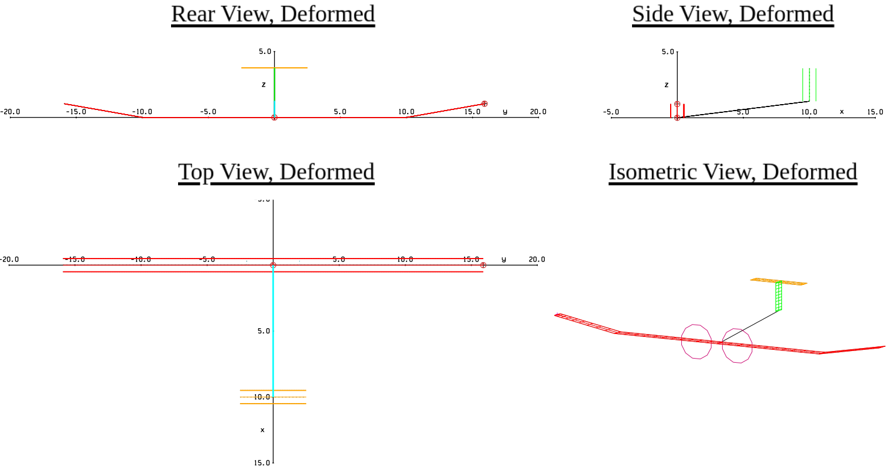
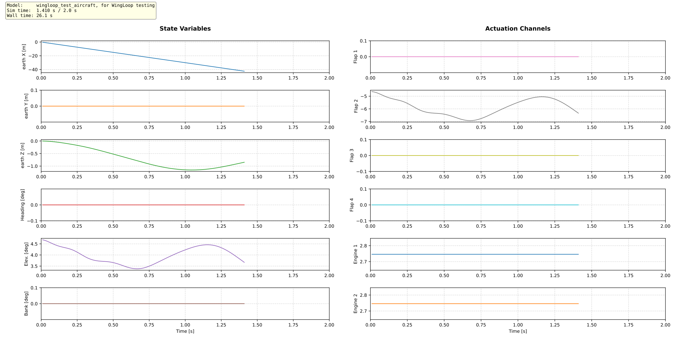
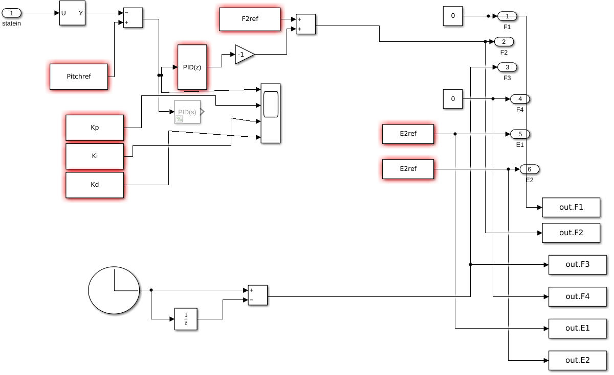
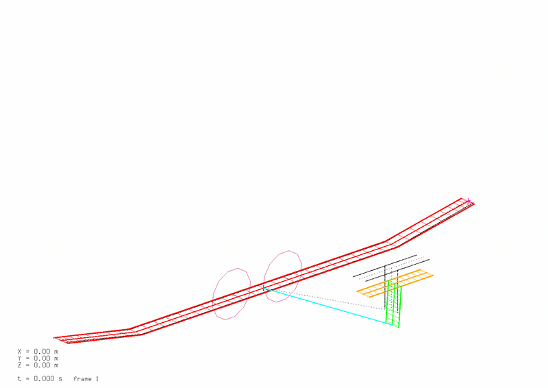
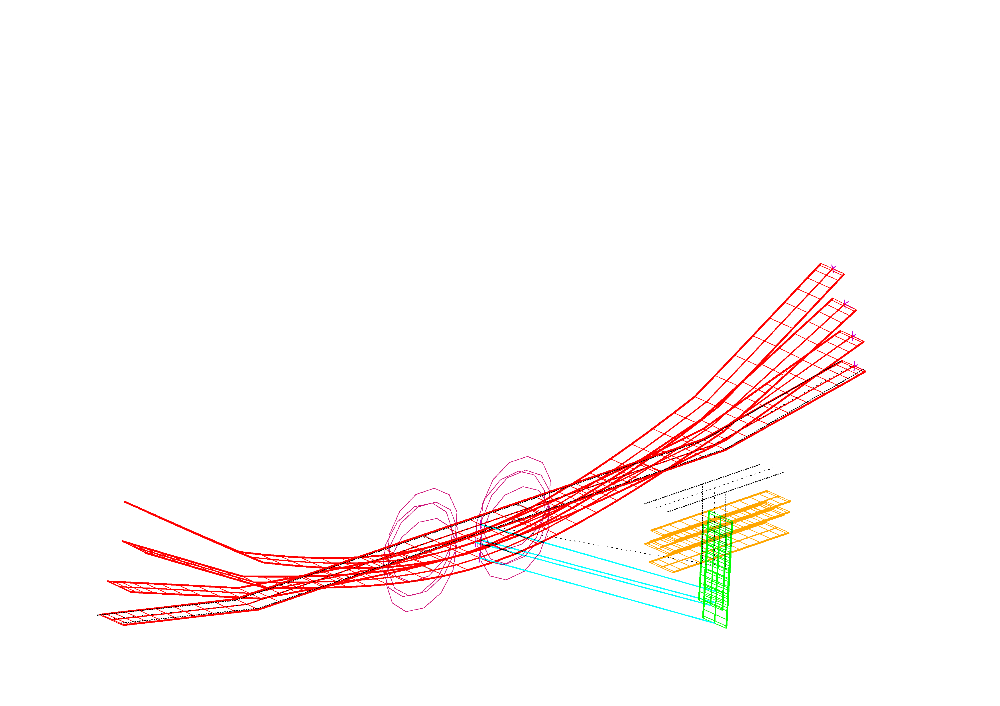

## WingLoop 3.0
<div align="center">
  
</div>

**Authors:** Leonardo Avoni; Matteo Alfonso Incarbone (Simulink V2)  
**Contact:** avonileonardo@gmail.com  
**Last Modified:** 11/2026  
**Platform:** Ubuntu (tested). Windows + WSL: provided for Simulink V2, **untested**  
**Tested with:** ASWING 5.98 (stable build) and ASWING_Modified, MATLAB/Simulink R2025b

---

## Overview

WingLoop is a closed-loop control framework that extends the capabilities of [ASWING](https://web.mit.edu/drela/Public/web/aswing/), a structural and aerodynamic analysis tool for flexible aircraft. While ASWING natively supports only linear bi-scheduled controllers, WingLoop integrates ASWING with Python — and optionally MATLAB or Simulink — to enable arbitrary control laws, including nonlinear strategies.

The simulation advances in a time-marching loop, either step by step or in chunks of *K* timesteps. Between iterations, the simulation state is passed to Python — and then to MATLAB or Simulink if needed — where the control laws are computed. The resulting control inputs are returned to ASWING for the next timestep, enabling closed-loop simulations with arbitrary controllers.

### What is new in 3.0

- **Speed.** WingLoop waits for ASWING's prompts instead of fixed timers and busy loops: with a Python
  controller a step costs about the same as ASWING alone (see [Performance](#performance-results)), and no CPU
  thread is spent spinning, which matters for parallel runs.
- **Simulink V2** (method by M. A. Incarbone): the controller model runs as one continuous Simulink
  simulation, exchanging data with WingLoop over TCP. Same model rules as the other Simulink backends, same
  results, a few ms per step instead of hundreds.
- **Data integrity.** Point files are checked for completeness, every point is recorded exactly once
  (including retries), the time grid is complete (K·Dt … N·Dt, optionally t = 0) at full precision.
- **Robustness.** A timeout on every ASWING command; a hung or crashed ASWING ends the run with a clear
  status instead of blocking. Optional retry of non-converged steps (off by default: ASWING_Modified
  sub-steps failed steps itself).
- **Diagnostics and metadata** per step (convergence, Newton restarts, TSPLIT sub-steps, retries, every
  command the controller returned) and per run (ASWING binary and hash, WingLoop commit, settings, wall time).
- **Compact output** (`.npz`: about 3× smaller than V2's `.json.gz` for the full record, and read without
  parsing text; `.json.gz` can still be written and read).
- **Packaging.** `pip install -e .` in any environment; MATLAB and FMPy are optional.
- Tests that need no ASWING, and a cross-check of all controller backends.

### Reference Publication

> Leonardo Avoni, Murat Bronz, Jean-Philippe Condomines and Jean-Marc Moschetta.  
> *"Enhancing ASWING Flight Dynamics Simulations with Closed-Loop Control for Flexible Aircraft,"*  
> AIAA 2025-3425. AIAA AVIATION FORUM AND ASCEND 2025. July 2025.  
> https://arc.aiaa.org/doi/10.2514/6.2025-3425

---

## Installation

From the repository root (the folder that contains `pyproject.toml`):

```bash
pip install -e .                # core: numpy, matplotlib
pip install -e .[fmu,test]      # optional: FMPy (.fmu controllers), pytest
```

MATLAB, MATLAB-Simulink and Simulink V2 controllers also need the **MATLAB Engine API for Python**, whose
version must match your MATLAB release (R2025b → 25.2):

```bash
pip install "matlabengine==25.2.*"
```

WingLoop needs an ASWING executable. Give its path (or its folder) to `Launch_ASWING(aswing_fullpath=...)`;
a shell alias (`aswing_alias="aswing_stable"`, resolved through `bash`) works as a fallback.

After installation:

```python
from WingLoop_Library import WingLoop, Aswing_Director, import_data_dict
```

`import WingLoop_Library` does not import MATLAB, FMPy or matplotlib; each is loaded only when used.

---

## Quick start

```python
from WingLoop_Library import WingLoop

WL = WingLoop()
WL.Launch_WingLoop_Control("python_controller", "python_test_controller.py", timestep=0.01)
WL.Launch_ASWING(aswing_fullpath="/path/to/ASWING/bin/aswing", sim_directory="aswing_geometry",
                 asw_filename="wingloop_test_aircraft.asw")
WL.Deactivate_Graphics()
for f in ["01_1minus_cosine.gust", "wingloop_test_aircraft.pnt", "wingloop_test_aircraft.set",
          "wingloop_test_aircraft.state"]:
    WL.Load_Files(f)
converged = WL.Time_Transient_Simulation(Dt=0.01, N=300, K=1)
WL.Outputting_The_Results("my_run")          # my_run.npz
WL.Closing_WingLoop()
```

Main options of `Time_Transient_Simulation`:

| option | default | meaning |
|---|---|---|
| `K` | 1 | steps per controller call (one record per chunk) |
| `record_initial` | False | also record the initial point at t = 0 |
| `stop_if_notconverged` | True | stop at the first non-converged step |
| `stop_callback` | None | `f(wingloop) -> bool`, after every chunk |
| `stop_condition` | None | `f(channels) -> bool` on the latest named values (`channels["Alpha"]`, …) |
| `retry_substeps` | 0 (off) | n > 1: re-march a non-converged chunk once in n·K steps of Dt/n |
| `aero_flags` | None | e.g. `{"freeze_vl": True, "lag": False}`: set and read back ASWING's k-menu flags |

`WL.sim_status` tells how the run ended (`completed`, `stopped: not converged at step k`, `hung at step k: …`,
`crashed at step k: …`). Other `WingLoop` features: `Launch_ASWING(write_timeout=..., input_filename=...,
output_filename=...)` (timeouts; per-instance exchange files for parallel runs), `Set_Aero_Flags`,
`Configure_Atmosphere_Update` (altitude-dependent atmosphere, M. A. Incarbone), `Configure_Recording`
(choice of recorded ASWING variables), `InitializePlot` (live plot; off unless asked).

---

## Repository Structure

```
WingLoop_Library/
├── WingLoop.py                 # Main loop director — orchestrates the full WingLoop execution
├── Aswing_Director.py          # Drives the ASWING process (prompt-synchronised commands, timeouts)
├── PyControl.py                # Controller backends: Python, MATLAB, Simulink V1, FMU, Simulink V2
├── SimulinkV2.py               # Simulink V2: Python side (TCP server)
├── simulink_v2/                # Simulink V2: MATLAB side
│   ├── AswingPlant.m           #   plant block (MATLAB System) exchanging data with WingLoop
│   ├── wingloop_v2_make_model.m#   builds <model>_wlv2.slx from a WingLoop controller model
│   ├── wingloop_v2_run.m       #   runs the simulation (called by WingLoop, or by the launcher)
│   └── wingloop_v2_windows_launcher.m  # MATLAB on Windows + WingLoop in WSL (untested)
├── PyControl_IO.py             # Reads ASWING point files; writes control files; .npz/.json output
├── PyControl_Plot.py           # Real-time and post-run plotting utilities
├── ASW_Helpers.py              # Videos, stroboscopic images, timeseries plots
├── PyControl_additional.py     # Legacy code from earlier WingLoop versions
├── test_files/                 # small fixtures (test aircraft, controllers, point files)
└── wingloop_testrun/
    ├── wingloop_testrun.py     # one run of the test case, any backend
    ├── run_all_backends.py     # all backends + cross-check report
    ├── aswing_geometry/
    ├── python_controller/  matlab_controller/  simulink_controller/
    └── results/                # V2 PID validation results
tests/                          # pytest suite (fake ASWING, no ASWING needed)
```

---

## Supported Controller Types

The extension of the controller file selects the backend. Every backend receives the full ASWING state
vector at each controller step and returns `{"F1": .., "E1": .., ...}` (flaps F1–F20, engines E1–E20).

| backend | file | selected by | needs |
|---|---|---|---|
| Python | `UserController` class in a `.py` | `.py` | — |
| MATLAB | `UserController.m` (classdef) | `.m` | MATLAB Engine |
| Simulink V1 | `.slx`, one `sim()` per step | `.slx` | MATLAB Engine, Simulink |
| Simulink FMU | `.fmu` (FMI 2.0 co-simulation) | `.fmu` (`rebuild_fmu_file=True` re-exports it from the `.slx`) | FMPy (+ Simulink Coder to re-export) |
| **Simulink V2** | `.slx`, one `sim()` for the whole run | `.slx` + `simulink_mode="v2"` | MATLAB Engine, Simulink |

A Python `UserController.step` may take a third argument, `channels`: the named ASWING values of the same
state (`channels["Alpha"]`, `channels["Time"]`, `channels["VIAS"]`, …). Keys a controller returns that are not
ASWING commands (e.g. `"recovery": 1`) are recorded (`cmd_recovery`) but not sent to ASWING.

**Open-loop controllers (Python).** A `UserController` with `schedule(times) -> {name: array}` gets its
commands for the whole run written once to an ASWING time-history file (one row per step). If it also has
`takeover(channels) -> bool`, WingLoop checks it after every step and, from the first `True`, calls `step()`
every chunk (closed loop), e.g. for a recovery controller. The check is made at every step, so no step needs
to be rolled back.

**Timing.** The command applied over [t_k, t_k + K·Dt] is computed from the state at t_k, from t_0 on, for every
backend. ASWING's own controller acts inside each step, so it leads WingLoop by one step (see TestRun).

---

## Simulink V2

Simulink V1 calls `sim()` once per WingLoop step; each call goes through Simulink's full start-up, which makes
it about ten times slower than ASWING itself. Simulink V2 (method by Matteo Alfonso Incarbone) runs the
controller model in **one** `sim()` for the whole run: the ASWING aircraft is a MATLAB System block,
`AswingPlant`, which at every Simulink step receives the ASWING state from WingLoop and sends back the command
computed by the controller.

You write the same model as for Simulink V1 and the FMU (see the rules below). WingLoop builds a wrapper,
`<model>_wlv2.slx`, in which `statein` is driven by `AswingPlant` and the command Outports feed it, and
rebuilds it when the model changes. `AswingPlant` has no direct feedthrough, so the controller sees the state
y_k at Simulink time t_k and its command u_k goes to ASWING for the next step: exactly the timing of the other
backends, without an algebraic loop.

```python
WL.Launch_WingLoop_Control("simulink_controller", "simulink_test_controller.slx", timestep=Dt,
                           simulink_mode="v2")
```

The model is built and compiled at the first controller step (it needs the state length); this takes
about 30 s and is reported as start-up. Data go over a local TCP connection (a free port is chosen, so
parallel runs do not collide).

**Windows + WSL (untested).** With MATLAB on Windows and WingLoop/ASWING in WSL, WingLoop cannot start
MATLAB. Use `simulink_launch="external"` and `simulink_handshake_file=...` in your WingLoop script, and start
the run from MATLAB with `simulink_v2/wingloop_v2_windows_launcher.m`, which starts your script in WSL, waits for
the handshake file and runs the simulation. This path is provided but has not been tested.

---

## WingLoop TestRun

The `wingloop_testrun` case is designed to assess WingLoop's behavior and performance across all supported controller types. A simple PID controller is applied to the aircraft shown below, featuring 4 groups of control surfaces and two engines. The same controller is implemented in six different ways: Python, MATLAB, Simulink V1, compiled Simulink (FMU), Simulink V2, and ASWING's native controller format. All ASWING-relevant files (trimming state, gust file, ASWING controller file, etc.) are located in the `aswing_geometry` folder.

<div align="center">
  
  <p><em>Test aircraft configuration</em></p>
</div>

To run the test case (one backend), or every backend with the cross-check:

```bash
cd WingLoop_Library/wingloop_testrun
python wingloop_testrun.py py            # py | mat | sim | fmu | fmu_rebuild | simv2 | fixed | native
python run_all_backends.py               # writes results_v3/report.md and comparison.png
```

`run_all_backends.py` runs each backend in its own process and its own copy of the case, and compares every
backend with the Python run: commanded elevator, and every ASWING state relative to its range. A backend
passes if the differences are at round-off level and it is not one step early or late. It exits with an
error otherwise, so it can be used as a regression test.

<div align="center">
  
  <p><em>WingLoop GUI during a simulation run</em></p>
</div>

> **Note on the ASWING-native case:** when using the ASWING built-in controller, WingLoop is bypassed entirely — the controller is integrated directly within the ASWING execution. Results are equivalent to the WingLoop cases, with the exception of a one-timestep lag inherent to the WingLoop coupling method.

### Scenario

The controller objective is to stabilize the aircraft in response to a 1-cosine gust.

**Flight conditions:**
- Leveled, horizontal flight at $V_{\infty} = 30\ \mathrm{m/s}$
- 1-cosine vertical gust (frozen-flow) applied as perturbation: distance to gust start −15 m, gust zero-to-peak distance 15 m, peak vertical velocity 3 m/s

**Simulation parameters:** $N = 300$, $K = 1$, $\Delta t = 0.01\ \mathrm{s}$

**PID gains:** $K_P = 100\ \mathrm{[deg/rad]}$, $K_I = 100\ \mathrm{[deg/(rad \cdot s)]}$, $K_D = 20\ \mathrm{[deg \cdot s/rad]}$

### Performance Results

BENCHMARK_SECTION

---
## Rules for Writing a Simulink Controller

These rules apply to Simulink V1, the FMU and Simulink V2 alike.

As a reference, the example controller in the `simulink_controller` folder demonstrates
all of the above rules. Its block diagram is shown below. Note that this controller has no
physical meaning and was written purely to exercise and validate the WingLoop–Simulink
interface.

<div align="center">
  
  <p><em>Block diagram of simulink_test_controller.slx.</em></p>
</div>

**Solver settings** (Model Settings → Solver → Solver Selection):
set the solver type to "Fixed-step" and the solver to "discrete (no continuous states)".
The fixed-step size can be left as `-1` (auto/inherited) — WingLoop will enforce its own
timestep `Dt` at runtime.

**Use discrete blocks only.** Continuous blocks are incompatible with the discrete solver
and will cause errors or incorrect results.

**Retrieving the current timestep** inside the model: use a Clock block, feed it into a
Unit Delay, and subtract the Unit Delay output from the Clock output. The result equals
the current simulation timestep `Dt`.

**Derivative filter coefficient `N`** (relevant for any block with a derivative term,
such as the Discrete PID): always use a filtered derivative. The filter pole is located
at `1 - N·Dt`, so `N·Dt > 1` places it outside the unit circle and causes instability
even when an equivalent Python or MATLAB controller is stable.

Validation tests across Dt = {2×10⁻², 1×10⁻², 5×10⁻³} s show that `N·Dt = 1.0`
produces identical results across all WingLoop controller backends (Python, MATLAB,
Simulink, and FMU), and is therefore the recommended value. Choosing `N·Dt > 1.0`
leads to unstable Simulink behavior.

It is strongly recommended to use the already available  `Nfilter = 1.0 / Dt` defined from 
WingLoop in the `.slx` file. This ensures consistency with whatever timestep `Dt` is set in 
WingLoop, with no manual edits to the Simulink model required. This method does not prohibit 
the user from enforcing a value of `N` different from `Nfilter`.

**Inputs:** place a single Inport block named `statein`. This receives the full WingLoop
state vector at each timestep. **New in 3.0:** set its port dimensions to `WL_NumStates`
(and use `WL_NumStates` wherever the model needs the state length, e.g. the input port width
of a Selector). WingLoop pushes `WL_NumStates` (the length of the ASWING state vector) to the
MATLAB base workspace before the model is compiled: the length depends on the aircraft and on
the ASWING build (the test aircraft has 1945 states with the build the V2 example models were
made with, and 2040 with the current stable build).

**Outputs:** for each control command, add both:
- an Outport block, and
- a To Workspace block pointing to the same signal,

using ASWING-compatible signal names (e.g. `F1`, `F2`, `E1`, `E15`). Both are required:
the Outport is used by WingLoop to read the controller output, and the To Workspace block
enables signal logging and inspection in the Simulink workspace. (Simulink V2 and the FMU read the Outports
only.)

**Workspace variables:** blocks that reference MATLAB workspace variables (gains, lookup
tables, filter coefficients, etc.) do not need those variables to exist inside the `.slx`
file itself. Any variable your Simulink model needs must instead be declared and pushed to
the MATLAB base workspace inside `UserController.m`, using `assignin('base', ...)` in the
constructor. WingLoop guarantees that `UserController.m` is executed before the first
`sim()` call, so all variables will be available when Simulink runs.

---

## Output data

`Outputting_The_Results(name)` writes `name.npz` (default) or, with `fmt="json"`, the V2 `name.json.gz`.
`import_data_dict(path)` reads both and returns the V2 layout:

```python
d = import_data_dict("my_run.npz")
d["ModelVariables"]["Alpha"]["values"]   # one value per recorded step, d["ModelVariables"]["Alpha"]["unit"]
d["ModelStates"]                          # (steps × states) array: the full ASWING state
d["ModelParameters"], d["Metadata"]       # state block sizes; run settings, ASWING hash, WingLoop commit, status
```

Besides ASWING's global variables (`Time`, `earth X`, `Alpha`, `F1`…`E20`, `CL`, …), WingLoop records per
step `IsConverged`, `NewtonRestarts`, `TSplits`, `Retried` (0 none, 1 retried and converged, 2 retried and
not converged), `Time_ASWING` (ASWING's 4-decimal time; `Time` is k·Dt in full precision), `cmd_<name>` for
every value the controller returned, and with ASWING_Modified `alpha_ref`, `beta_ref` (reference-point flow
angles). In `.npz` the states are stored in single precision: ASWING computes in single precision and
prints 9 significant digits, so float32 keeps exactly ASWING's values.

---

## Parallel runs

Run each WingLoop in its own process (WingLoop changes the working directory), with its own case folder or
its own exchange files (`Launch_ASWING(input_filename="input_w03", output_filename="output_w03")`). Resolve the
ASWING path once in the main process and pass `aswing_fullpath` to the workers (resolving a shell alias in many
processes at once can hang). WingLoop runs ASWING with single-threaded BLAS (`OMP_NUM_THREADS=1`, …). ASWING
stores at most 10001 points, so one run is limited to 9997 steps.

---

## Upgrading from WingLoop 2.0

- The first chunk is now controlled and recorded: records are at K·Dt, …, N·Dt (V2: the first chunk used the
  trim controls and was not recorded, and the run ended at (N−1)·Dt). Controllers are called from t = 0.
- `Outputting_The_Results` writes `.npz`; pass `fmt="json"` for `.json.gz`. `import_data_dict` reads both.
- The retry of non-converged steps is off by default (`retry_substeps=10` restores V2's behaviour).
- Simulink models: size `statein` with `WL_NumStates` (see the rules above).
- `Launch_ASWING` defaults: `write_timeout=1200` s; `timer_text` is only used with `sync="timer"` (V2 mode).
- `Performing_K_iterations_ASWING` was a V2 internal and is gone; use `Time_Transient_Simulation`.

---

## Tests

```bash
python -m pytest            # repository root; no ASWING or MATLAB needed
```

The suite drives a fake ASWING (`tests/fake_aswing.py`, which prints ASWING's prompts and writes real point
files) to check the time grid, that no sample is lost or duplicated (also with retries), hang and crash
handling, controller timing and command logging, open-loop schedules, k-menu flags, output files and the
parser (truncated files, engines on several pylons). `run_all_backends.py` (above) is the end-to-end check with
ASWING and MATLAB.

---
## Multimedia Export

The **Wingloop** module also includes several utilities for analyzing ASWING outputs, including video generation and stroboscopic image export (`ASW_Helpers.py`; video options by M. A. Incarbone). `python wingloop_testrun.py py --video` writes the `.state` file of the run and a video.

<div align="center">
  
  <p><em>Flexible aircraft simulation (video output).</em></p>
</div>

<div align="center">
  
  <p><em>Flexible aircraft simulation (stroboscopic view).</em></p>
</div>

---
## License

WingLoop is licensed under **[CC BY-NC-SA 4.0](https://creativecommons.org/licenses/by-nc-sa/4.0/)** — free for non-commercial use with attribution.

**Commercial use is not permitted under this license.** If you wish to use WingLoop in a commercial context, please contact the author to discuss a separate agreement:
**Leonardo Avoni** — avonileonardo@gmail.com

If you use WingLoop in academic work, please cite:
> Leonardo Avoni, Murat Bronz, Jean-Philippe Condomines and Jean-Marc Moschetta.
> *"Enhancing ASWING Flight Dynamics Simulations with Closed-Loop Control for Flexible Aircraft,"*
> AIAA 2025-3425. AIAA AVIATION FORUM AND ASCEND 2025. July 2025.
> https://arc.aiaa.org/doi/10.2514/6.2025-3425

See [`LICENCE`](LICENCE), [`CONTRIBUTING.md`](CONTRIBUTING.md) and [`CONTRIBUTORS.md`](CONTRIBUTORS.md).
